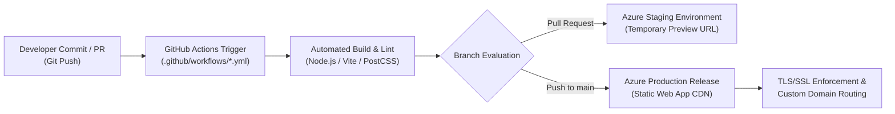

# 🚀 DevSecOps & Automated CI/CD Pipeline Architecture

[](https://github.com)
[](https://github.com/S23rez)
[](https://azure.microsoft.com)
[](https://docker.com)
[](https://firebase.google.com)

This repository documents the design, implementation, and deployment of an automated **DevSecOps Continuous Integration and Continuous Deployment (CI/CD)** pipeline developed by **Odunuga Fatai Olayinka**.

The pipeline automatically validates, builds, packages, and deploys a modern cloud-native web application (**T.O.C Online Fashion Store**) to **Microsoft Azure Static Web Apps** using **GitHub Actions**, with containerization support via **Docker** and authentication governance via **Firebase Authentication**.

---

## 🏗️ Pipeline Architecture & Deployment Flow



---

## 🛠️ Key Technical Features & Implementations

### 1. ⚙️ Automated GitHub Actions Workflow
* **Workflow Configuration:** Located in [`.github/workflows/azure-static-web-apps-lively-beach-0ac7b7303.yml`](file:///c:/Users/Suarez/My-Portfolios/Cloud-Projects/CI-CD%20Pipeline/T.O.C-Online-Fashion-Store/.github/workflows/azure-static-web-apps-lively-beach-0ac7b7303.yml).
* **Triggers:** Automated execution on pushes to branch `main` and on pull request open/synchronize/close events.
* **Secret Protection:** Deployment credentials are never hardcoded; they are securely ingested at runtime via `secrets.AZURE_STATIC_WEB_APPS_API_TOKEN_LIVELY_BEACH_0AC7B7303`.
* **Staging Previews:** Pull requests generate isolated staging preview environments that automatically close and destroy upon PR merge.

### 2. 🛡️ DevSecOps & Security Hardening
* **Environment Variable Isolation:** Production Firebase API keys and environment configurations are separated via `.env` injection and repository secrets.
* **Client-Side Identity Protection:** Firebase Authentication (`authService.js`) enforces strict JWT token verification and role boundaries for customer sessions.
* **Container Packaging:** Includes a dedicated [`Dockerfile`](file:///c:/Users/Suarez/My-Portfolios/Cloud-Projects/CI-CD%20Pipeline/T.O.C-Online-Fashion-Store/toc-store/Dockerfile) and `.dockerignore` for immutable microservice container builds, eliminating build-time artifacts from production containers.
* **Static Asset Integrity:** Enforces Content Delivery Network (CDN) caching headers and strict Content Security Policies (CSP) to mitigate Cross-Site Scripting (XSS).

---

## 📁 Repository Directory

```text
CI-CD Pipeline/
├── 📄 README.md                                     <- This Pipeline Architecture Guide
└── 📂 T.O.C-Online-Fashion-Store/                   <- Cloud-Native Web Application
    ├── 📄 README.md                                 <- Storefront Overview
    ├── 📂 .github/workflows/                        <- GitHub Actions CI/CD Definitions
    │   └── 📄 azure-static-web-apps-lively-beach-0ac7b7303.yml
    └── 📂 toc-store/                                <- React + Vite + Tailwind Source Application
        ├── 📄 README.md                             <- Full Technical Specification (7.3 KB)
        ├── 📄 Dockerfile                            <- Container Build Definition
        ├── 📄 package.json                          <- Dependency Manifest
        ├── 📄 vite.config.js                        <- Build & Bundling Settings
        └── 📂 src/
            ├── 📂 firebase/                         <- Firebase Auth & Product Storage Services
            ├── 📂 components/                       <- Reusable UI Components
            └── 📂 pages/                            <- Application Route Views
```

---

## 🚀 Execution & Local Verification

```bash
# 1. Navigate to the store application
cd "Cloud-Projects/CI-CD Pipeline/T.O.C-Online-Fashion-Store/toc-store"

# 2. Install dependencies
npm install

# 3. Run development server locally
npm run dev

# 4. Build production static bundle
npm run build

# 5. Build Docker container image
docker build -t toc-store:latest .
```

---

## 👤 Author

**Odunuga Fatai Olayinka**  
Cybersecurity Specialist | Systems & Cloud Security Engineer  
* GitHub: [@S23rez](https://github.com/S23rez)
