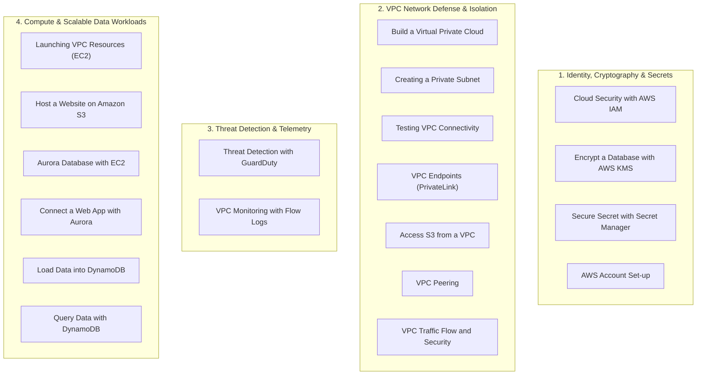

# 🔶 AWS Cloud Architecture & Security Engineering Labs

A comprehensive suite of **19 hands-on Amazon Web Services (AWS) labs** engineered and validated by **Odunuga Fatai Olayinka**. This repository demonstrates production-grade cloud security architectures, multi-tier network topologies, automated threat detection, cryptographic key management, private transit endpoints, and resilient database workloads.

---

## 📋 Comprehensive Catalog of 19 AWS Labs

---

## 📁 Detailed Lab Directory & Security Highlights

### 🛡️ Category 1: Identity Governance, Secrets & Cryptography

| Lab Directory | Core Services | Security Focus & Implementation Details | Documentation Link |
| :--- | :--- | :--- | :--- |
| **Cloud Security with AWS IAM** | IAM, MFA, STS, JSON Policies | Implements least-privilege permissions, granular resource-based policies, role assumption (STS), and multi-factor authentication (MFA) enforcement. | [Lab Guide](file:///c:/Users/Suarez/My-Portfolios/Cloud-Projects/aws-labs/Cloud%20Security%20with%20AWS%20IAM/README.md) |
| **Encrypt a Database with AWS KMS** | AWS KMS, RDS Aurora, CMK | Configures Customer-Managed Keys (CMK), envelope encryption, key rotation policies, and encrypted database snapshot validation at rest. | [Lab Guide](file:///c:/Users/Suarez/My-Portfolios/Cloud-Projects/aws-labs/Encrypt%20a%20Database%20with%20AWS%20KMS/README.md) |
| **Secure Secret with Secret Manager** | Secrets Manager, IAM, RDS | Eliminates hardcoded credentials in application code through dynamic API-driven secret retrieval and automated credential rotation. | [Lab Guide](file:///c:/Users/Suarez/My-Portfolios/Cloud-Projects/aws-labs/Secure%20Secret%20with%20Secret%20Manager/README.md) |
| **AWS Account Set-up** | AWS Organizations, CloudTrail, Billing | Establishes root account hardening, CloudTrail multi-region audit trails, budget alerts, and AWS security baselines. | [Lab Guide](file:///c:/Users/Suarez/My-Portfolios/Cloud-Projects/aws-labs/AWS%20Account%20Set-up/README.md) |

---

### 🌐 Category 2: Virtual Private Cloud (VPC) Defense & Network Isolation

| Lab Directory | Core Services | Security Focus & Implementation Details | Documentation Link |
| :--- | :--- | :--- | :--- |
| **Build a Virtual Private Cloud** | VPC, Subnets, IGW, Route Tables | Constructs customized VPC CIDR blocks, separates public and private tiers, and manages explicit route table associations. | [Lab Guide](file:///c:/Users/Suarez/My-Portfolios/Cloud-Projects/aws-labs/Build%20a%20Virtual%20Private%20Cloud/README.md) |
| **Creating a Private Subnet** | Private Subnets, NAT Gateway, EIP | Deploys NAT Gateways with Elastic IPs allowing outbound internet access for patching while denying inbound unsolicited traffic. | [Lab Guide](file:///c:/Users/Suarez/My-Portfolios/Cloud-Projects/aws-labs/Creating%20a%20Private%20Subnet/README.md) |
| **Testing VPC Connectivity** | ICMP, TCP, Route Tracing, EC2 | Validates inter-subnet packet reachability, route propagation, and security group filtering across multi-tier subnets. | [Lab Guide](file:///c:/Users/Suarez/My-Portfolios/Cloud-Projects/aws-labs/Testing%20VPC%20Connectivity/README.md) |
| **VPC Endpoints** | AWS PrivateLink, Interface Endpoints | Provisions interface VPC endpoints allowing private compute instances to access AWS APIs without traversal across the public internet. | [Lab Guide](file:///c:/Users/Suarez/My-Portfolios/Cloud-Projects/aws-labs/VPC%20Endpoints/README.md) |
| **Access S3 from a VPC** | S3 Gateway Endpoint, Bucket Policies | Configures private S3 Gateway Endpoints with IAM endpoint policies restricting access exclusively to internal VPC CIDRs. | [Lab Guide](file:///c:/Users/Suarez/My-Portfolios/Cloud-Projects/aws-labs/Access%20S3%20from%20a%20VPC/README.md) |
| **VPC Peering** | VPC Peering Connection, Routing | Interconnects distinct VPCs with non-overlapping IP address spaces, updating route tables and security groups to facilitate secure cross-VPC communication. | [Lab Guide](file:///c:/Users/Suarez/My-Portfolios/Cloud-Projects/aws-labs/VPC%20Peering/README.md) |
| **VPC Traffic Flow and Security** | NACLs, Security Groups | Demonstrates stateful vs. stateless traffic filtering, configuring network ACL rule orders and security group ingress/egress boundaries. | [Lab Guide](file:///c:/Users/Suarez/My-Portfolios/Cloud-Projects/aws-labs/VPC%20Traffic%20Flow%20and%20Security/README.md) |

---

### 🚨 Category 3: Threat Detection & Security Telemetry

| Lab Directory | Core Services | Security Focus & Implementation Details | Documentation Link |
| :--- | :--- | :--- | :--- |
| **Threat Detection with GuardDuty** | AWS GuardDuty, CloudWatch, Findings | Activates intelligent threat detection using machine learning and threat intelligence feeds to identify reconnaissance, compromised instances, and exfiltration attempts. | [Lab Guide](file:///c:/Users/Suarez/My-Portfolios/Cloud-Projects/aws-labs/Threat%20Detection%20with%20GuardDuty/README.md) |
| **VPC Monitoring with Flow Logs** | VPC Flow Logs, CloudWatch Logs, IAM | Captures IP traffic metadata (ACCEPT / REJECT) across VPC network interfaces, publishing logs to CloudWatch for forensics and anomaly investigation. | [Lab Guide](file:///c:/Users/Suarez/My-Portfolios/Cloud-Projects/aws-labs/VPC%20Monitoring%20with%20Flow%20Logs/README.md) |

---

### 🗄️ Category 4: Cloud Compute, Storage & Scalable Databases

| Lab Directory | Core Services | Security Focus & Implementation Details | Documentation Link |
| :--- | :--- | :--- | :--- |
| **Launching VPC Resources** | EC2, Key Pairs, Security Groups | Securely provisions EC2 instances across isolated subnets with SSH key pair authentication and restricted management access. | [Lab Guide](file:///c:/Users/Suarez/My-Portfolios/Cloud-Projects/aws-labs/Launching%20VPC%20Resources/README.md) |
| **Host a Website on Amazon S3** | Amazon S3, Static Hosting, CORS | Configures S3 static hosting, enforcing granular public read policies, CORS rules, and secure origin validation. | [Lab Guide](file:///c:/Users/Suarez/My-Portfolios/Cloud-Projects/aws-labs/Host%20a%20Website%20on%20Amazon%20S3/README.md) |
| **Aurora Database with EC2** | Amazon Aurora MySQL/PostgreSQL, EC2 | Deploys a fault-tolerant multi-AZ Aurora cluster placed within private DB subnet groups, protected by database-tier security groups. | [Lab Guide](file:///c:/Users/Suarez/My-Portfolios/Cloud-Projects/aws-labs/Aurora%20Database%20with%20EC2/README.md) |
| **Connect a Web App with Aurora** | EC2 Web Server, Aurora Cluster | Connects a front-end compute tier to a backend Aurora cluster, enforcing network segmentation and application-layer access controls. | [Lab Guide](file:///c:/Users/Suarez/My-Portfolios/Cloud-Projects/aws-labs/Connect%20a%20Web%20App%20with%20Aurora/README.md) |
| **Load Data into DynamoDB** | DynamoDB, AWS CLI, Shell Automation | Automates batch data ingestion into managed DynamoDB NoSQL tables with primary partition keys and attribute schemas. | [Lab Guide](file:///c:/Users/Suarez/My-Portfolios/Cloud-Projects/aws-labs/Load%20Data%20into%20DynamoDB/README.md) |
| **Query Data with DynamoDB** | DynamoDB, Secondary Indexes, CLI | Executes high-performance key-condition queries and projection expressions while maintaining data partition integrity. | [Lab Guide](file:///c:/Users/Suarez/My-Portfolios/Cloud-Projects/aws-labs/Query%20Data%20with%20DynamoDB/README.md) |

---

## 👤 Author

**Odunuga Fatai Olayinka**  
Cybersecurity Specialist | Systems & Cloud Security Engineer  
* GitHub: [@S23rez](https://github.com/S23rez)
