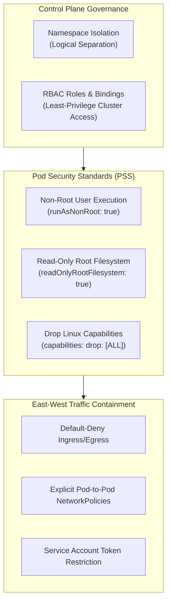

# ☸️ Kubernetes Workload Orchestration & Security Architecture

[](https://kubernetes.io)
[](https://github.com/S23rez)
[](#)
[](https://cncf.io)

A declarative workload orchestration and cluster security architecture repository developed by **Odunuga Fatai Olayinka**. This project outlines best practices for container orchestration, zero-trust network policies, role-based access control (RBAC), and container workload isolation within **Kubernetes**.

---

## 🏗️ Architectural Core Principles



---

## 🛡️ Core Security Controls & Design Blueprints

### 1. 🔒 Pod Security Standards (Restricted Profile)
All application workload pods are engineered to comply with the Kubernetes **Restricted** security profile:
* **Privilege Escalation Prevention:** Enforces `allowPrivilegeEscalation: false` to stop sub-processes from acquiring more privileges than their parent.
* **Non-Root Runtime:** Enforces `runAsNonRoot: true` with explicit unprivileged user UIDs (e.g., `runAsUser: 10001`).
* **Filesystem Lockdown:** Configures `readOnlyRootFilesystem: true` to prevent attackers from dropping binaries or modifying system files at runtime. Ephemeral storage is isolated to designated `emptyDir` volumes.
* **Linux Capabilities:** Strips all default capabilities (`drop: ["ALL"]`) and explicitly adds only required capabilities if strictly necessary.

### 2. 🌐 NetworkPolicies for Micro-Segmentation
Zero-Trust networking is enforced inside the cluster using Kubernetes `NetworkPolicy` resources:
* **Default Deny Policy:** Automatically applied to every namespace to disallow all unapproved ingress and egress traffic.
* **Explicit Whitelisting:** Permits ingress traffic only from verified ingress controllers and egress traffic only to declared backend database services.
* **Cross-Namespace Containment:** Prevents lateral movement across tenant boundaries.

### 3. 🔑 Role-Based Access Control (RBAC) & Secret Management
* **Service Accounts:** Workload pods execute under dedicated, least-privileged `ServiceAccount` objects with `automountServiceAccountToken: false` unless API access is explicitly required.
* **RoleBindings:** Scoped strictly to specific namespaces using `Role` and `RoleBinding` rather than cluster-wide `ClusterRoleBinding`.
* **Encrypted Secrets:** Ingested securely via Kubernetes Secrets and mapped as environment variables or volume mounts.

---

## 📋 Recommended Manifest Structure

```text
kubernetes-manifests/
├── 📄 README.md                        <- Architecture & Security Blueprint
├── 📄 00-namespace.yaml                <- Tenant Namespace Isolation
├── 📄 01-rbac.yaml                     <- Least-Privilege Roles & ServiceAccounts
├── 📄 02-network-policy.yaml           <- Default Deny & Whitelisted Ingress/Egress
├── 📄 03-configmap-secrets.yaml        <- Application Configuration & Secret Mappings
└── 📄 04-deployment.yaml               <- Hardened Pod Security Context Deployment
```

---

## 👤 Author

**Odunuga Fatai Olayinka**  
Cybersecurity Specialist | Systems & Cloud Security Engineer  
* GitHub: [@S23rez](https://github.com/S23rez)
