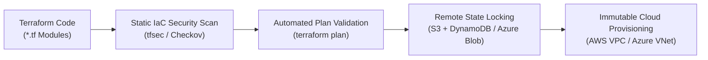

# 🏗️ Terraform Infrastructure as Code (IaC) & Cloud Security Baselines

[](https://terraform.io)
[](https://github.com/S23rez)
[](#)
[](#)

A declarative Infrastructure as Code (IaC) repository developed by **Odunuga Fatai Olayinka**. This project documents enterprise cloud provisioning architectures, immutable infrastructure patterns, and static security scanning standards using **HashiCorp Terraform**.

---

## 🏗️ IaC Security Philosophy



---

## 🛡️ Core Security Standards in Terraform Engineering

### 1. 🔒 Encrypted Remote State Architecture
* **State Encryption at Rest:** Terraform state files (`terraform.tfstate`) contain sensitive metadata and must be protected. Remote backends are configured with customer-managed encryption (AWS KMS / Azure Key Vault).
* **State Locking:** Employs distributed locking mechanisms (e.g., DynamoDB lock tables or Azure Blob lease locking) to prevent concurrent state corruption and race conditions during continuous delivery runs.

### 2. 🛡️ Shift-Left Static Analysis & Policy-as-Code
Before executing `terraform apply`, configurations are analyzed against security benchmarks:
* **tfsec & Checkov Scanning:** Identifies misconfigurations prior to deployment (e.g., open security groups `0.0.0.0/0`, unencrypted S3 buckets, missing logging configurations).
* **CIS Benchmark Alignment:** Implements cloud provider CIS Foundation Benchmarks directly into module defaults.

### 3. 🌐 Declarative Network Hardening
* **Multi-Tier Subnetting:** Standardized definitions separating public web tiers, private application tiers, and completely isolated database tiers.
* **Strict Ingress/Egress Declarations:** Eliminates wildcard security rules, enforcing explicit port mappings, protocol constraints, and referenced security group IDs.
* **Default-Encrypted Storage:** Mandates encryption at rest (`encrypted = true`) across all provisioned EBS volumes, S3 buckets, RDS databases, and Azure Managed Disks.

---

## 📁 Repository Structure

```text
terraform-deployments/
├── 📄 README.md                        <- Architecture & IaC Security Guide
├── 📄 main.tf                          <- Provider Configuration & Core Resources
├── 📄 variables.tf                     <- Strongly Typed Inputs & Descriptions
├── 📄 outputs.tf                       <- Explicit Resource Attribute Exports
└── 📄 terraform.tfvars.example         <- Non-Sensitive Parameter Template
```

---

## 🚀 Execution Workflow

```bash
# 1. Initialize backend and providers
terraform init

# 2. Format and validate syntax
terraform fmt -check
terraform validate

# 3. Perform static security scan
checkov -d .

# 4. Generate speculative execution plan
terraform plan -out=tfplan

# 5. Apply verified changes
terraform apply tfplan
```

---

## 👤 Author

**Odunuga Fatai Olayinka**  
Cybersecurity Specialist | Systems & Cloud Security Engineer  
* GitHub: [@S23rez](https://github.com/S23rez)
